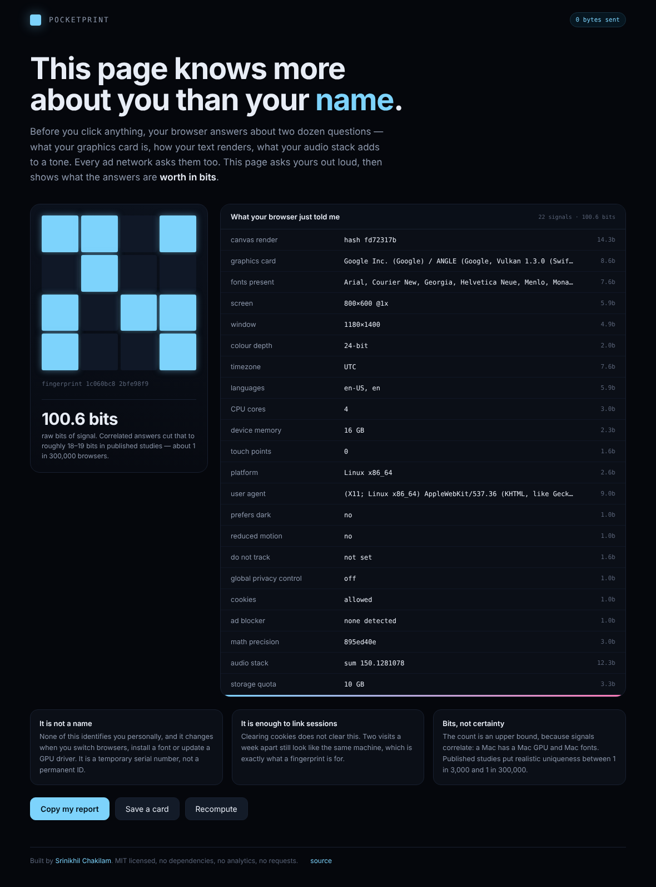

# pocketprint

[](https://github.com/rawqubit/pocketprint/actions/workflows/ci.yml) [](https://github.com/rawqubit/pocketprint/blob/main/LICENSE) [](https://github.com/rawqubit/pocketprint)

**What every website already knows about you — on one page, in one second.**

Your browser answers about two dozen questions before you click anything: what
graphics card you have, how your text antialiases, what your audio stack adds to
a tone, which fonts you installed. Ad networks hash those answers into a number
that survives clearing your cookies. This page asks yours out loud.

**[rawqubit.github.io/pocketprint](https://rawqubit.github.io/pocketprint/)** — nothing to install, nothing to sign up for, nothing to upload.



## What it shows

- **22 signals**, each with the actual value your browser handed over and what
  that value is worth in bits. Values that a browser rounds or estimates say so
  on hover — device memory is a bucket, and "fonts visible" is what font
  measurement can infer, not a list of files.
- **The pixels your GPU drew** and **the waveform your audio stack produced**,
  rendered under the table: the two probes that make you unique, shown instead of
  summarised.
- **Where the bits come from** — the top contributors as bars, next to the honest
  comparison: the raw sum against the ~18 bits that survive correlation in the
  2010 study.
- **The record, verbatim**: the JSON a tracker would keep, on the page, copyable.
- **A drift check**: press Recompute after resizing the window or installing a
  font and it names exactly which signals moved and which held.
- **A fingerprint**: the same kind of hash a tracker would store, built from your
  answers, plus a 4×4 avatar so the thing has a face.
- **A report you can copy** and a 1200×630 card you can post.
- **A number with honest error bars.** The page prints the raw bit sum and then
  says the part most privacy tools hide: those bits correlate. Published
  measurements of full desktop fingerprints (Eckersley 2010, Panopticlick 2016)
  land near **18–19 bits**, roughly 1 in 300,000 browsers — which is still more
  than enough to follow one laptop around the web.

## The signals

Canvas rendering · WebGL vendor and renderer · audio stack · installed fonts ·
screen size and pixel ratio · window size · colour depth · timezone · languages ·
CPU cores · device memory · touch points · platform · user agent · dark mode ·
reduced motion · Do Not Track · Global Privacy Control · cookies · ad blocker ·
math precision · storage quota.

Every one is read from the browser you are already running. There is no server,
no beacon, no cookie, and no request: the page wraps `fetch` and
`XMLHttpRequest` on load and the counter in the header stays at **0 bytes**.

The one thing it stores is the previous run's values in `sessionStorage`, so the
drift check can tell you what changed. That is tab-local, never sent, and gone
when you close the tab — the source is 40 lines if you want to check.

## Run it

```bash
git clone https://github.com/rawqubit/pocketprint
cd pocketprint
python3 -m http.server 8080   # open http://localhost:8080
```

## Tests

```bash
node --test test/fp.test.mjs
```

Six tests cover the parts that can be wrong in a way you would not notice:
the FNV-1a hash, the bucket→bits conversion, clamping at the tail so the page
never prints `1 in Infinity`, the human-readable scale, and the deterministic
avatar grid.

## Honest limits

- **Bits are not people.** The raw sum treats signals as independent. They are
  not. The page says so next to the number instead of burying it.
- **Your value changes.** Install a font, plug in a monitor, update a driver, or
  switch from Wi-Fi to a phone hotspot, and the hash moves. That is why a
  fingerprint links sessions, not lifetimes.
- **It is a demo of the idea, not a production tracker.** There is no server-side
  correlation, no cookie syncing, and no keystroke timing here.
- **Safari and Firefox expose less.** Expect more "not exposed" rows, a shorter
  list, and fewer bits — which is the point.

## License

MIT, © Srinikhil Chakilam.
